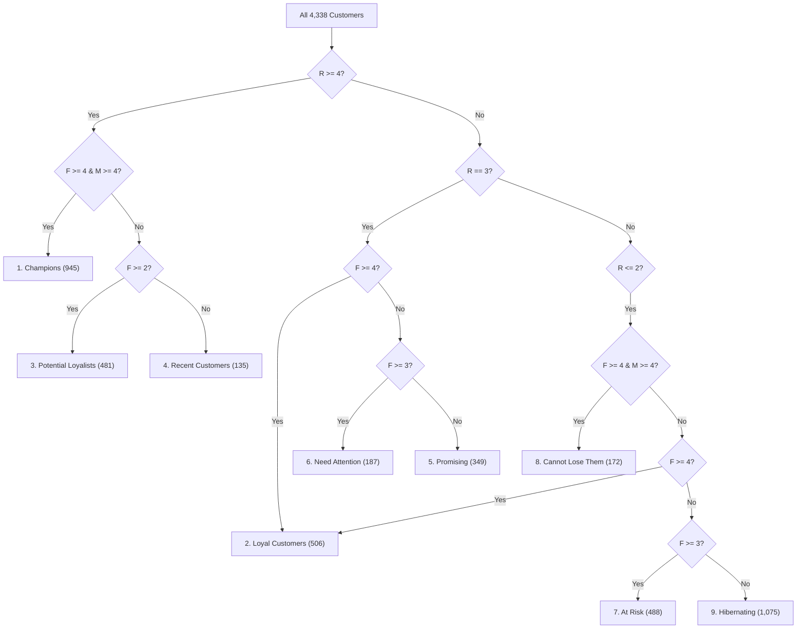

# Customer Segmentation & RFM Analysis – End-to-End Analytics Platform

An enterprise-grade Customer Segmentation and RFM (Recency, Frequency, Monetary) analytics pipeline transforming raw transactional records into actionable behavioral clusters, multi-sheet financial Excel workbooks, relational SQLite databases, and an interactive Streamlit & Plotly analytics dashboard.

---

## 1. Project Overview

In competitive retail environments, treating all customers uniformly results in inefficient marketing expenditure, missed cross-sell opportunities, and unmitigated churn. This project provides an end-to-end data engineering and analytics solution for customer segmentation using the **RFM (Recency, Frequency, Monetary)** framework applied to over **541,000 raw retail transactions**.

The project encompasses:
- **Python Data Engineering Pipeline**: Automated data auditing, rigorous cleansing, quantile-based RFM scoring, and behavioral segmentation.
- **Relational SQL Database (`retail_analysis.db`)**: 10 production-ready analytical SQL queries for revenue attribution, cohort tracking, and Pareto analysis.
- **Multi-Sheet Financial Excel Workbook (`analysis_workbook.xlsx`)**: 7 professionally formatted worksheets featuring native charts, conditional formatting, and executive KPI cards.
- **Interactive Streamlit Web Dashboard (`src/dashboard.py`)**: Real-time analytical dashboard with dynamic multi-dimensional filtering, Plotly visualizations, and customer exploration tools.
- **Power BI Enterprise Integration Guide (`reports/power_bi_guide.md`)**: Star schema data models, Power Query type specifications, and production DAX formulas.
- **Automated Validation Test Suite (`tests/validate_pipeline.py`)**: 53 automated reconciliation checks verifying 100% mathematical accuracy against ground-truth benchmarks.

---

## 2. Problem Statement

Modern e-commerce and retail businesses face three fundamental customer data challenges:
1. **Data Quality Degradation**: Unregistered customer purchases, cancelled orders, negative stock adjustments, and zero-price sample lines obscure genuine sales performance.
2. **Lack of Behavioral Differentiation**: Aggregated revenue figures mask which customer cohorts drive profitability and which are at imminent risk of attrition.
3. **Siloed Analytical Deliverables**: Raw data models often fail to translate into accessible, multi-channel formats required by executive leadership, operational marketers, and BI engineers.

---

## 3. Business Objectives

- **Identify Core Value Drivers**: Isolate the **Champions** cohort driving over 64% of total revenue to maximize retention and loyalty rewards.
- **Detect Attrition Early**: Segment **At Risk** and **Cannot Lose Them** customers who previously transacted heavily but haven't purchased recently.
- **Optimize Marketing ROI**: Focus acquisition, cross-sell, and reactivation campaigns on specific cohorts (e.g., **Potential Loyalists**, **Recent Customers**, **Need Attention**).
- **Ensure Reconciled Financial Reporting**: Guarantee that transaction line sums, customer-level monetary totals, and segment revenues reconcile exactly to **£8,911,407.90**.

---

## 4. Dataset Source and Attribution

- **Dataset**: Online Retail Dataset
- **Provider**: UCI Machine Learning Repository / Dr. Daqing Chen (School of Engineering, London South Bank University)
- **Period**: December 1, 2010 to December 9, 2011
- **File Location**: `data/Online Retail.xlsx`
- **Original Volume**: 541,909 records across 8 transactional features:
  - `InvoiceNo`: 6-digit integral transaction identifier. Invoices starting with 'C' indicate cancellations.
  - `StockCode`: 5-digit integral product code.
  - `Description`: Nominal product/item name.
  - `Quantity`: Quantities of each product per transaction.
  - `InvoiceDate`: Invoice generation timestamp.
  - `UnitPrice`: Product price per unit in Sterling (£).
  - `CustomerID`: 5-digit integral unique customer identifier.
  - `Country`: Customer residence country.

---

## 5. Technologies Used

- **Core Programming**: Python 3.11+
- **Data Engineering & Analytics**: Pandas, NumPy
- **Relational Database**: SQLite3, ANSI SQL
- **Spreadsheet Automation**: XlsxWriter, OpenPyXL
- **Interactive Visualizations & Dashboard**: Streamlit, Plotly Express & Graph Objects
- **Business Intelligence**: Microsoft Power BI Desktop (DAX & Power Query)
- **Validation & Quality Assurance**: Automated Python unittest/reconciliation engine
- **Environment & Automation**: Windows PowerShell / Batch (`run_project.bat`)

---

## 6. Project Folder Structure

```text
D:\Customer_Segmentation_RFM\
├── data/
│   └── Online Retail.xlsx               # Source transactional dataset (541,909 records)
├── src/
│   ├── analyze.py                       # Core ETL, cleaning, RFM scoring & export pipeline
│   ├── dashboard.py                     # Interactive Streamlit & Plotly web dashboard
│   └── excel_report.py                  # Multi-tab styled Excel generator with native charts
├── sql/
│   ├── analysis_queries.sql             # Complete master suite of 10 analytical SQL queries
│   ├── 01_total_unique_customers.sql    # Distinct customer count
│   ├── 02_customer_distribution_by_segment.sql
│   ├── 03_top_10_highest_spending_customers.sql
│   ├── 04_revenue_by_customer_segment.sql
│   ├── 05_monthly_sales_analysis.sql    # Monthly revenue & orders (DISTINCT InvoiceNo)
│   ├── 06_country_wise_revenue.sql      # Geographic revenue distribution
│   ├── 07_average_rfm_metrics_by_segment.sql
│   ├── 08_high_value_customers.sql      # High-spend customers (> £2,000)
│   ├── 09_total_unique_invoices.sql     # Distinct invoice count
│   └── 10_customer_revenue_contribution.sql # Cumulative Pareto analysis
├── output/
│   ├── cleaned_transactions.csv         # 397,884 clean transaction line records
│   ├── customer_rfm.csv                 # 4,338 customer-level RFM profiles and segments
│   ├── segment_summary.csv              # 9 behavioral segment benchmarks & shares
│   ├── data_quality_report.csv          # 17-step data cleaning audit log
│   ├── retail_analysis.db               # SQLite database with 4 production tables
│   └── analysis_workbook.xlsx           # 7-worksheet professional formatted Excel report
├── reports/
│   └── power_bi_guide.md                # Enterprise Power BI import, schema & DAX guide
├── tests/
│   └── validate_pipeline.py             # 53 automated validation and reconciliation tests
├── backup/                              # Original project file snapshots prior to enhancements
├── requirements.txt                     # Project dependencies
├── run_project.bat                      # 1-click execution batch script
├── .gitignore                           # Git ignore rules for virtual environments & caches
└── README.md                            # Comprehensive project documentation
```

---

## 7. Data Cleaning Process

Data quality checks are recorded at every stage without silently dropping records. All filtering is tracked in `output/data_quality_report.csv` and the `data_quality_report` SQLite table:

| Step | Metric / Audit Check | Row Count | Operational Impact & Rationale |
| :---: | :--- | :---: | :--- |
| **1** | **Raw Records Loaded** | **541,909** | Baseline source transactions from `Online Retail.xlsx`. |
| **2** | **Missing CustomerID** | **135,080** | Excluded guest checkouts lacking customer attribution. |
| **3** | **Missing InvoiceNo** | **0** | Confirmed zero null invoice identifiers. |
| **4** | **Missing InvoiceDate** | **0** | Confirmed complete timestamp validity. |
| **5** | **Missing Description** | **1,454** | Audited raw items lacking textual description. |
| **6** | **Raw Duplicate Records** | **5,268** | Audited identical row occurrences in raw dataset. |
| **7** | **Records with CustomerID** | **406,829** | Transactions retained after customer identification filter. |
| **8** | **Cancelled Invoices (`C`)** | **8,905** | Excluded cancellation and return invoices from positive sales. |
| **9** | **Non-Positive Quantity** | **0** | Verified zero non-positive quantities remaining. |
| **10** | **Non-Positive UnitPrice** | **40** | Excluded zero-price internal sample lines. |
| **11** | **Cleaned Valid Transactions** | **397,884** | **Final preserved transaction line items.** |
| **12** | **Unique Customers** | **4,338** | Distinct registered paying customer IDs. |
| **13** | **Unique Invoices (Orders)** | **18,532** | Distinct invoice numbers (`COUNT(DISTINCT InvoiceNo)`). |
| **14** | **Total Valid Revenue** | **£8,911,407.90** | Total monetary volume (`Quantity × UnitPrice`). |
| **15** | **Date Range** | **Dec 1, 2010 – Dec 9, 2011** | 13 calendar months of sales operations. |
| **16** | **RFM Reference Date** | **2011-12-10 12:50:00** | Max invoice date + 1 day used as recency benchmark. |

---

## 8. RFM Methodology

RFM analyzes customer transaction history across three key dimensions:

1. **Recency ($R$)**:
   $$\text{Recency} = \text{Reference Date} - \max(\text{InvoiceDate}_i) \quad (\text{in days})$$
   Where Reference Date is set to **December 10, 2011** (1 day after the maximum transaction date in the dataset). Lower recency indicates more recent engagement.

2. **Frequency ($F$)**:
   $$\text{Frequency} = \text{Distinct Invoices Counted} = \text{COUNT}(\text{DISTINCT InvoiceNo}_i)$$
   Measures distinct purchase occasions. Line items within the same invoice are not counted as multiple orders.

3. **Monetary ($M$)**:
   $$\text{Monetary} = \sum (\text{Quantity} \times \text{UnitPrice})$$
   Total lifetime revenue generated by customer $i$.

### Quantile Scoring
Customers are assigned scores from **1 to 5** across each dimension using 5 equal quantiles (quintiles):
- **$R\text{-Score}$**: Inverted scoring where the lowest recency days receive score 5 (most recent) and highest receive score 1.
- **$F\text{-Score}$**: Higher order frequency receives score 5, lowest receives score 1.
- **$M\text{-Score}$**: Highest monetary spend receives score 5, lowest receives score 1.
- **Tie-Breaking**: Handled safely via `rank(method="first")` before `pd.qcut` partitioning to prevent boundary duplicate errors.
- **Combined Score**: Concatenated as a 3-character string: $\text{RFM Score} = [R][F][M]$ (ranging from `111` to `555`).

---

## 9. Segmentation Rules & Reference Counts

Customers are segmented into 9 distinct behavioral categories. Every customer belongs to exactly one segment:



### Exact Reconciled Segment Breakdown

| Customer Segment | Customer Count | Share of Customers | Total Revenue (£) | Share of Revenue | Avg Recency | Avg Frequency | Avg Monetary | Strategic Focus |
| :--- | :---: | :---: | :---: | :---: | :---: | :---: | :---: | :--- |
| **Champions** | **945** | 21.78% | £5,743,052.84 | 64.45% | 12.5 days | 11.2 orders | £6,077.30 | VIP rewards, early access, retention |
| **Loyal Customers** | **506** | 11.66% | £941,247.07 | 10.56% | 37.4 days | 5.2 orders | £1,860.17 | Upsell, referral incentives, reviews |
| **Potential Loyalists**| **481** | 11.09% | £499,879.07 | 5.61% | 16.8 days | 2.0 orders | £1,039.25 | Onboarding series, bundle recommendations |
| **Recent Customers** | **135** | 3.11% | £43,896.09 | 0.49% | 17.9 days | 1.0 order | £325.16 | 2nd purchase vouchers, welcome nurture |
| **Promising** | **349** | 8.05% | £164,704.98 | 1.85% | 52.5 days | 1.2 orders | £471.93 | Social proof, category discovery perks |
| **Need Attention** | **187** | 4.31% | £169,001.01 | 1.90% | 51.3 days | 2.3 orders | £903.75 | Reactivation incentives, survey outreach |
| **At Risk** | **488** | 11.25% | £436,824.96 | 4.90% | 160.2 days | 2.7 orders | £895.13 | Personalized win-back, price discounts |
| **Cannot Lose Them** | **172** | 3.96% | £387,663.57 | 4.35% | 124.1 days | 5.5 orders | £2,253.86 | Direct phone/VIP outreach, renewal credit |
| **Hibernating** | **1,075** | 24.78% | £525,138.31 | 5.89% | 216.5 days | 1.1 orders | £488.50 | Automated liquidation emails or prune |
| **Total / Reconciled** | **4,338** | **100.00%** | **£8,911,407.90** | **100.00%** | **92.1 days** | **4.3 orders** | **£2,054.27** | Fully reconciled against benchmarks |

---

## 10. SQL Analysis & SQLite Database

The SQLite database at `output/retail_analysis.db` contains 4 fully normalized tables:
- `cleaned_transactions` (397,884 rows)
- `customer_rfm` (4,338 rows)
- `segment_summary` (9 rows)
- `data_quality_report` (17 rows)

All 10 required analytical SQL queries are saved inside `sql/analysis_queries.sql` as well as individual scripts:
1. `01_total_unique_customers.sql`: Unique customer count (`COUNT(DISTINCT CustomerID)`).
2. `02_customer_distribution_by_segment.sql`: Customer count & percentage per segment.
3. `03_top_10_highest_spending_customers.sql`: Top spenders with RFM profiles.
4. `04_revenue_by_customer_segment.sql`: Segment revenue attribution and spending averages.
5. `05_monthly_sales_analysis.sql`: Monthly revenue, distinct order count, active customers, and AOV.
6. `06_country_wise_revenue.sql`: Geographic revenue, distinct orders, and market share.
7. `07_average_rfm_metrics_by_segment.sql`: Segment average Recency, Frequency, and Monetary metrics.
8. `08_high_value_customers.sql`: Lifetime spend > £2,000 cohort extraction.
9. `09_total_unique_invoices.sql`: Total valid orders counted strictly using `COUNT(DISTINCT InvoiceNo)`.
10. `10_customer_revenue_contribution.sql`: Windowed cumulative Pareto revenue attribution.

---

## 11. Excel Reporting

The workbook at `output/analysis_workbook.xlsx` is generated using `XlsxWriter` with executive styling:
- **Sheet 1: Executive Summary**: High-level KPI cards, summary snapshot table, and strategic recommendations matrix.
- **Sheet 2: RFM Analysis**: Full 4,338 customer-level dataset with currency formatting, frozen header row, autofilters, and 3-color soft conditional formatting on scores.
- **Sheet 3: Segment Summary**: Aggregate segment table with two native Excel charts:
  - *Clustered Column Chart*: Customer Count by Segment.
  - *Doughnut Chart*: Revenue Distribution by Segment.
- **Sheet 4: Monthly Sales Analysis**: Monthly breakdown (13 months) with a native *Line Chart* showing revenue velocity.
- **Sheet 5: Country Analysis**: Geographic distribution table with a native *Horizontal Bar Chart* for Top 10 Markets.
- **Sheet 6: Top 10 Customers**: High-value client profiles with a native *Column Chart* displaying spend comparison.
- **Sheet 7: Data Quality**: Step-by-step audit log and reconciliation checkpoints.

---

## 12. Interactive Streamlit Dashboard

The web dashboard is located at `src/dashboard.py` and provides:
- **Real-Time Dynamic Filters**:
  - Customer Segment multiselect.
  - Country multiselect.
  - Transaction date range picker.
- **Dynamic KPI Cards**: Total Revenue, Total Customers, Unique Orders, and Average Monetary Value.
- **5 Comprehensive Analytical Tabs**:
  1. *Segment Overview*: Customer volume bars, revenue share donut, and comparative RFM metric groups.
  2. *RFM Analysis*: Interactive Recency vs. Monetary scatter plot (bubble size = Frequency, log scale Y) and Top 10 customer visualizer.
  3. *Sales & Geographic Trends*: Dual-axis monthly revenue & order volume trend + geographic market breakdown.
  4. *Customer Explorer*: Searchable customer directory by CustomerID with one-click filtered CSV export.
  5. *Data Quality & Audit*: Pipeline cleaning log and reconciliation badges.

---

## 13. How to Install Dependencies

Ensure Python 3.10+ is installed. Clone or navigate to the project directory and install requirements:

```powershell
# Navigate to the project root
cd D:\Customer_Segmentation_RFM

# Activate the virtual environment
.\.venv\Scripts\Activate.ps1

# Install requirements
pip install -r requirements.txt
```

---

## 14. How to Run the Project

### Option A: 1-Click Automated Batch Run (Recommended)
Double-click `run_project.bat` or run from Command Prompt / PowerShell:

```cmd
.\run_project.bat
```

This script will automatically:
1. Activate `.venv`.
2. Verify and install dependencies.
3. Run `src/analyze.py` to process data, populate the SQLite DB, and build the Excel workbook.
4. Run `tests/validate_pipeline.py` to execute all 53 validation checks.
5. Launch the Streamlit dashboard in your default browser.

### Option B: Manual Execution via PowerShell

```powershell
# Step 1: Run core ETL and RFM analysis
& ".\.venv\Scripts\python.exe" "src\analyze.py"

# Step 2: Run automated validation test suite
& ".\.venv\Scripts\python.exe" "tests\validate_pipeline.py"

# Step 3: Launch interactive dashboard
& ".\.venv\Scripts\streamlit.exe" run "src\dashboard.py"
```

---

## 15. Key Findings & Business Insights

1. **Revenue Concentration (Pareto Principle)**:
   - **Champions** make up **21.78%** of the customer base but account for **64.45% (£5.74M)** of total revenue.
   - The Top 10 highest-spending customers contribute over **£1.45M (16.3%)** of total sales.
2. **At-Risk Value**:
   - **At Risk** and **Cannot Lose Them** segments collectively represent **660 high-value customers** who have spent over **£824,000** but haven't transacted in 4 to 6 months. Proactive win-back outreach to these cohorts will deliver immediate high ROI.
3. **Geographic Anchoring**:
   - The **United Kingdom** accounts for **82.0% (£7.31M)** of valid retail revenue, followed by the Netherlands, EIRE (Ireland), and Germany.
4. **Seasonal Spike**:
   - Sales experience exponential growth in Q4, peaking in November 2011 at **£1.16M** across **64,531 items**, driven by holiday gifting behavior.

---

## 16. Limitations & Future Improvements

- **Wholesale vs. Retail Conflation**: The dataset combines B2B wholesale buyers (purchasing thousands of units) and individual B2C consumers. Future iterations can introduce a formal B2B flag based on median order quantity.
- **Product Affinity Clustering**: Combining RFM with market basket analysis (Apriori algorithm) to recommend specific product bundles to *Potential Loyalists*.
- **Predictive CLV Modeling**: Implementing probabilistic models (BG/NBD and Gamma-Gamma) to forecast future expected transactions and customer lifetime value.
- **Automated Alerting**: Integrating webhook alerts (Slack/Teams) when high-value Champions slip into the *At Risk* category.
