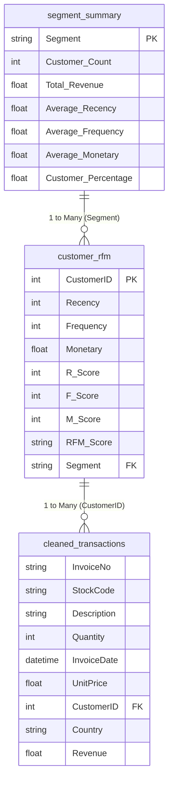

# Power BI Integration Guide: Customer Segmentation & RFM Analytics

This documentation provides the complete blueprint for importing, modeling, calculating DAX measures, and visualizing the Customer Segmentation & RFM Analysis results in Microsoft Power BI Desktop.

---

## 1. Overview of Data Files to Import

Import the following 4 clean CSV files generated in the `output/` directory:

| File Name | Purpose | Primary / Foreign Key | Expected Row Count |
| :--- | :--- | :--- | :--- |
| **`cleaned_transactions.csv`** | Fact table containing transaction lines, item quantities, prices, and revenue | `InvoiceNo`, `CustomerID` | **397,884** |
| **`customer_rfm.csv`** | Customer dimension containing RFM metrics, quantile scores, and assigned segments | `CustomerID` (PK), `Segment` (FK) | **4,338** |
| **`segment_summary.csv`** | Segment dimension with aggregated benchmarks, percentages, and metrics | `Segment` (PK) | **9** |
| **`data_quality_report.csv`** | Audit log detailing data cleaning steps and row reconciliations | `Step` | **17** |

---

## 2. Power Query Data Types Specification

When loading data via **Power Query Editor**, verify and enforce the following explicit data types:

### Table: `cleaned_transactions`
- `InvoiceNo`: **Text** *(critical: must be text to preserve invoice formatting)*
- `StockCode`: **Text**
- `Description`: **Text**
- `Quantity`: **Whole Number** (`Int64`)
- `InvoiceDate`: **Date/Time** (`DateTime`)
- `UnitPrice`: **Decimal Number** / **Fixed Decimal Number** (Currency)
- `CustomerID`: **Whole Number** (`Int64`)
- `Country`: **Text**
- `Revenue`: **Fixed Decimal Number** (Currency)

### Table: `customer_rfm`
- `CustomerID`: **Whole Number** (`Int64`) *(Primary Key)*
- `Recency`: **Whole Number** (Days)
- `Frequency`: **Whole Number** (Distinct Orders)
- `Monetary`: **Fixed Decimal Number** (Currency)
- `R_Score`: **Whole Number** (1 to 5)
- `F_Score`: **Whole Number** (1 to 5)
- `M_Score`: **Whole Number** (1 to 5)
- `RFM_Score`: **Text** (e.g., "555", "111")
- `Segment`: **Text**

### Table: `segment_summary`
- `Segment`: **Text** *(Primary Key)*
- `Customer_Count`: **Whole Number**
- `Total_Revenue`: **Fixed Decimal Number** (Currency)
- `Average_Recency`: **Decimal Number**
- `Average_Frequency`: **Decimal Number**
- `Average_Monetary`: **Fixed Decimal Number** (Currency)
- `Customer_Percentage`: **Percentage** (`0.0%` or divide by 100)

---

## 3. Data Model & Relationships (Star / Snowflake Schema)

In Power BI **Model View**, establish the following active relationships:



### Relationship Configuration Table:
1. **`customer_rfm` to `cleaned_transactions`**:
   - **From Column**: `customer_rfm[CustomerID]` (1)
   - **To Column**: `cleaned_transactions[CustomerID]` (*)
   - **Cardinality**: `1 to Many (1:*)`
   - **Cross Filter Direction**: `Single` (or `Both` if filtering customers by product attributes)
   - **Make this relationship active**: `Checked`

2. **`segment_summary` to `customer_rfm`**:
   - **From Column**: `segment_summary[Segment]` (1)
   - **To Column**: `customer_rfm[Segment]` (*)
   - **Cardinality**: `1 to Many (1:*)`
   - **Cross Filter Direction**: `Single`
   - **Make this relationship active**: `Checked`

3. **Recommended Date Dimension Table (DAX)**:
   ```dax
   DimDate = 
   ADDCOLUMNS (
       CALENDAR (DATE(2010, 12, 1), DATE(2011, 12, 31)),
       "Year", YEAR([Date]),
       "Month Number", MONTH([Date]),
       "Month Name", FORMAT([Date], "mmmm"),
       "Year-Month", FORMAT([Date], "yyyy-mm"),
       "Quarter", "Q" & FORMAT([Date], "q")
   )
   ```
   Connect: `DimDate[Date]` (1) to `cleaned_transactions[InvoiceDate]` (*).

---

## 4. Required DAX Measures

Create a dedicated measure table called `_Measures` and insert the following exact DAX formulas:

### 1. Total Customers
```dax
Total Customers = 
DISTINCTCOUNT(cleaned_transactions[CustomerID])
```
*Format: Whole Number with thousands separator (e.g. 4,338)*

### 2. Total Revenue
```dax
Total Revenue = 
SUM(cleaned_transactions[Revenue])
```
*Format: Currency (£#,##0.00)*

### 3. Total Unique Orders
```dax
Total Unique Orders = 
DISTINCTCOUNT(cleaned_transactions[InvoiceNo])
```
*Format: Whole Number with thousands separator (e.g. 18,532)*  
*Note: Always uses `DISTINCTCOUNT(InvoiceNo)` to avoid conflating transaction line items with orders.*

### 4. Average Recency
```dax
Average Recency = 
AVERAGE(customer_rfm[Recency])
```
*Format: Decimal Number (1 decimal place, e.g. 92.1 days)*

### 5. Average Frequency
```dax
Average Frequency = 
AVERAGE(customer_rfm[Frequency])
```
*Format: Decimal Number (1 decimal place, e.g. 4.3 orders)*

### 6. Average Monetary
```dax
Average Monetary = 
AVERAGE(customer_rfm[Monetary])
```
*Format: Currency (£#,##0.00)*

### 7. Revenue per Customer
```dax
Revenue per Customer = 
DIVIDE([Total Revenue], [Total Customers], 0)
```
*Format: Currency (£#,##0.00)*

### 8. Customer Percentage
```dax
Customer Percentage = 
DIVIDE(
    [Total Customers], 
    CALCULATE([Total Customers], ALL(customer_rfm)), 
    0
)
```
*Format: Percentage (`0.0%`)*

---

### Additional High-Value DAX Measures:
```dax
Average Order Value = 
DIVIDE([Total Revenue], [Total Unique Orders], 0)

Revenue Share Percentage = 
DIVIDE(
    [Total Revenue], 
    CALCULATE([Total Revenue], ALL(cleaned_transactions)), 
    0
)

High Value Customer Count = 
CALCULATE(
    [Total Customers],
    customer_rfm[Monetary] > 2000
)
```

---

## 5. Recommended Power BI Report Layout (3 Pages)

### Page 1: Executive KPI & RFM Segment Overview
- **Header**: "Customer Segmentation & RFM Analytics Executive Dashboard"
- **Top Card Row (4 Cards)**:
  1. `[Total Revenue]` (£8.91M)
  2. `[Total Customers]` (4,338)
  3. `[Total Unique Orders]` (18,532)
  4. `[Average Order Value]` (£480.87)
- **Visual 1 (Clustered Column Chart)**:
  - X-Axis: `customer_rfm[Segment]`
  - Y-Axis: `[Total Customers]`
  - Data Labels: On
- **Visual 2 (Donut Chart)**:
  - Legend: `customer_rfm[Segment]`
  - Values: `[Total Revenue]`
  - Tooltips: `[Revenue Share Percentage]`
- **Visual 3 (Matrix / Table)**:
  - Rows: `customer_rfm[Segment]`
  - Values: `[Total Customers]`, `[Customer Percentage]`, `[Total Revenue]`, `[Average Recency]`, `[Average Frequency]`, `[Average Monetary]`
- **Slicers**:
  - Segment Slicer (Dropdown / Tiles)
  - Country Slicer (Searchable)
  - Date Slider (`cleaned_transactions[InvoiceDate]`)

### Page 2: RFM Customer Matrix & Cohort Deep-Dive
- **Visual 1 (Scatter Plot)**:
  - X-Axis: `customer_rfm[Recency]`
  - Y-Axis: `customer_rfm[Monetary]` (Set to logarithmic scale)
  - Size: `customer_rfm[Frequency]`
  - Legend: `customer_rfm[Segment]`
  - Tooltips: `CustomerID`, `RFM_Score`
- **Visual 2 (Bar Chart)**:
  - Y-Axis: `CustomerID` (Top 10 filtered by `[Total Revenue]` descending)
  - X-Axis: `[Total Revenue]`
  - Color by `Segment`
- **Visual 3 (Heatmap / Matrix)**:
  - Rows: `customer_rfm[R_Score]` (1 to 5)
  - Columns: `customer_rfm[F_Score]` (1 to 5)
  - Values: `[Total Customers]` with conditional color background formatting

### Page 3: Geographic & Sales Velocity Trends
- **Visual 1 (Combo Line & Clustered Column Chart)**:
  - Shared X-Axis: `DimDate[Year-Month]`
  - Column Y-Axis: `[Total Revenue]`
  - Line Y-Axis (Secondary): `[Total Unique Orders]`
- **Visual 2 (Map or Horizontal Bar Chart)**:
  - Category: `cleaned_transactions[Country]`
  - Measure: `[Total Revenue]` (Top 10 markets)
- **Visual 3 (Table)**:
  - Country, Revenue, Distinct Orders, Active Customers, AOV

---

## 6. Verification and Validation Checklist

Before publishing the Power BI report, confirm that your card visuals match the ground-truth benchmarks:

- [ ] **Total Revenue**: `£8,911,407.90`
- [ ] **Cleaned Transactions**: `397,884`
- [ ] **Unique Customers**: `4,338`
- [ ] **Unique Invoices**: `18,532`
- [ ] **Champions Count**: `945`
- [ ] **Hibernating Count**: `1,075`
- [ ] **Loyal Customers Count**: `506`
- [ ] **At Risk Count**: `488`
